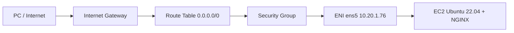

# Praktikum Cloud Computing - Pertemuan 2 (PTI2802)

**Nama:** Sihab Assidiqi
**NIM:** 25832073003
**Provider:** AWS (Amazon Web Services)
**Region:** ap-southeast-1 (Singapore)
**Pengganti Resource Group:** Tag `course=PTI2802`

## Tujuan
Membangun satu server (VM) di cloud dari nol lewat AWS CLI, mengamankan aksesnya,
menjalankan layanan web (NGINX), menguji perilaku firewall, mendokumentasikan
troubleshooting, lalu menghapus semua resource dan membuktikannya.

## Pemetaan Azure ke AWS
| Modul (Azure) | AWS |
|---|---|
| Subscription | AWS Account |
| Resource Group | Tag `course=PTI2802` |
| VNet / Subnet | VPC / Subnet |
| NSG | Security Group |
| VM | EC2 Instance |
| Public IP | Auto-assign public IP |
| Azure RBAC | IAM |
| Deallocate | Stop instance |

## Topologi

## Resource yang dibuat
| Resource | Konfigurasi |
|---|---|
| IAM user | `cc-p2-sihab` (policy `AmazonEC2FullAccess`, bukan root) |
| VPC | 10.20.0.0/16 |
| Subnet | 10.20.1.0/24 (ap-southeast-1a), auto-assign public IP |
| Internet Gateway + Route Table | Default route 0.0.0.0/0 ke IGW, diasosiasikan ke subnet |
| Security Group | SSH (22) hanya dari IP publik PC dengan /32; HTTP (80) dibuka sementara untuk eksperimen |
| Key pair | ed25519, hanya public key yang diimpor ke AWS |
| EC2 | t3.micro, Ubuntu 22.04 LTS, EBS 8 GB gp2 |
| Aplikasi | NGINX |

Semua resource diberi tag `Name=cc-p2-<NIM>-<jenis>`, `course=PTI2802`, `meeting=2`.

## Langkah yang dikerjakan
1. Menyiapkan akun: MFA root, membuat IAM user, memasang AWS CLI v2, `aws configure`.
2. Membuat jaringan: VPC, subnet, Internet Gateway, route table, asosiasi.
3. Membuat Security Group dengan SSH hanya dari IP publik sendiri.
4. Membuat SSH key dan mengimpor public key ke AWS.
5. Membuat EC2 dan masuk lewat SSH; mengeksplorasi server (IP, route, port, disk, memori).
6. Memasang NGINX; menguji akses dari luar sebelum dan sesudah port 80 dibuka, lalu mencabut rule.
7. Troubleshooting: SSH timeout karena IP publik berubah.
8. Observasi IAM.
9. Stop VM dan memeriksa disk.
10. Inventory, cleanup berurutan, dan verifikasi bersih.

## Daftar evidence (`evidence/`)
| File | Isi |
|---|---|
| 01-cli-version.txt | Versi AWS CLI dan SSH |
| 02-account-redacted.txt | Identitas akun (Account ID disensor) |
| 04-vnet.txt | VPC, subnet, route table |
| 05-nsg.txt | Security Group dan rule SSH |
| 06-vm-status.txt | Status VM (running, t3.micro, IP) |
| 07-network.txt | Eksplorasi server (ip addr, ip route, ss, df, free) |
| 08-ssh.txt | Bukti login SSH |
| 09-nginx-vm.txt | NGINX sehat dari dalam VM |
| 09-nginx.txt | curl dari luar: sebelum, sesudah, dan setelah rule dicabut |
| 09-nginx-before.png / 09-nginx-after.png | Screenshot browser timeout vs halaman NGINX |
| 10-troubleshoot.txt | Kasus SSH timeout (Masalah sampai Verifikasi) |
| 11-iam.txt | Observasi IAM |
| 12-stop-volume.txt | VM stopped, volume EBS masih ada |
| 13-inventory.txt | Daftar resource sebelum cleanup |
| 14-cleanup.txt, 14-cleanup-ec2.png, 14-cleanup-console.png | Bukti semua resource terhapus |

## Hasil utama
- Dengan Security Group yang belum membuka port 80, `curl localhost` di VM berhasil tetapi akses dari luar timeout. Setelah port 80 dibuka, halaman NGINX muncul.
- IP publik VM berubah setiap stop/start, dan IP publik PC juga bisa berubah saat berpindah jaringan sehingga SSH timeout sampai rule diperbarui.
- Akses IAM user terbatas: pemanggilan IAM dan SSM ditolak (AccessDenied).
- Semua resource terhapus dan terverifikasi kosong lewat CLI dan Console.

## Catatan keamanan
- Tidak memakai root account untuk praktikum.
- Private key dan access key tidak disertakan di repository.
- Account ID disensor (`XXXXXXXXXXXX`) di file teks dan screenshot.

Refleksi dan jawaban soal analisis ada di [reflection.md](reflection.md).